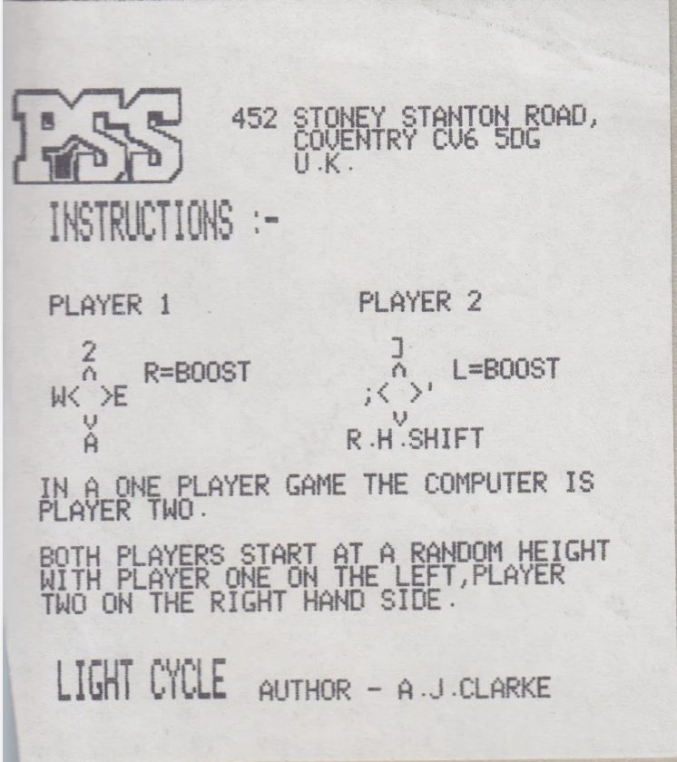
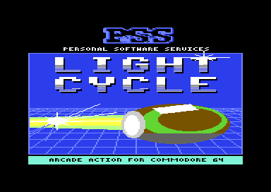
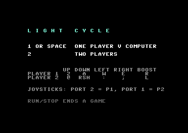
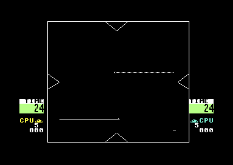
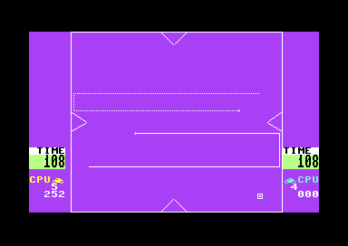
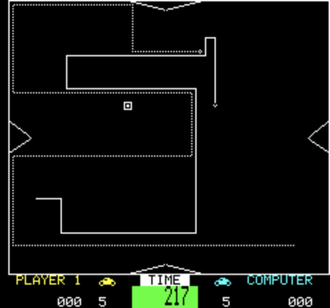
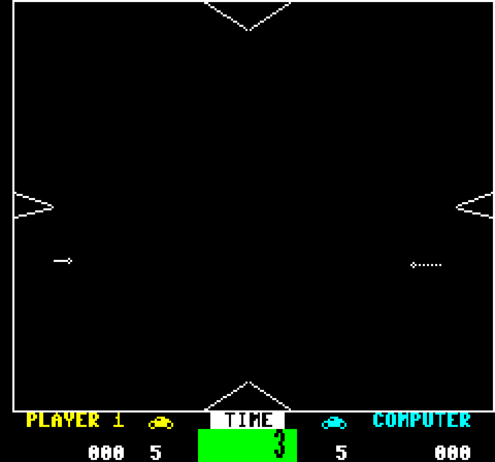

# LIGHT CYCLE

A Commodore 64 version of *Light Cycle*, the two-player light-cycle game A.J. Clarke wrote for the Oric-1 and Atmos and
Personal Software Services (PSS) of Coventry published on cassette in 1983. The C64 version runs the original game
logic, ported routine by routine, on a new C64 platform layer.

The Oric original is here too. `CYCLE.TAP` is the 1983 tape, and `oric/` holds its full, commented 6502 source, which
assembles with cc65 back into a tape byte-identical to the original, ready to load in any Oric emulator.



---

## The Game

Two light cycles race round a walled arena, each leaving a trail that never fades. A cycle that touches any lit pixel,
a wall, a trail or a block, crashes. Each wall has a wedge of random size pointing inward, the paper colour is picked
at random, and every so often a new block lands in an empty spot, so the arena slowly fills. Holding boost moves a
cycle faster. Player 1 rides against a second player or against the computer, which hunts player 1 down and slows as
it closes in. When one cycle crashes, the other player scores the running TIME plus 200; each player has five lives,
and the higher score at the end earns a place among the eight *Light Cycle Heroes*.

| Keys (C64)        | Does                                                |
|:------------------|:----------------------------------------------------|
| 2 W E A           | Player 1: up, left, right, down; or joystick port 2 |
| R                 | Player 1 boost (fire on the joystick)               |
| @ : ; Right SHIFT | Player 2: up, left, right, down; or joystick port 1 |
| L                 | Player 2 boost (fire on the joystick)               |
| 1, SPACE or fire  | Start a one-player game against the computer        |
| 2                 | Start a two-player game                             |
| RUN/STOP          | End the game                                        |

The C64 keys keep the Oric layout's shape, since the C64 has no `]` or `'` key. The full rules, menus, scoring and the
computer's tactics are in the [player's guide](docs/player_guide.md).

---

## Screenshots

The C64 version:

| C64                                                         | C64                                                            |
|:------------------------------------------------------------|:---------------------------------------------------------------|
|     |  |
|  |     |

The Oric original, captured from the running game and redrawn by the game's own code:

| The Oric game                                                       | Drawn by the game's code                                          |
|:--------------------------------------------------------------------|:------------------------------------------------------------------|
|  |  |

---

## The Versions

| Version       | Machine       | What it is                                                   |
|:--------------|:--------------|:-------------------------------------------------------------|
| C64 version   | C64           | The Oric game logic on a new C64 platform layer; in progress |
| Oric original | Oric-1, Atmos | The 1983 tape and its source, rebuilt byte for byte          |

The C64 version plays the Oric rules: the same arena, wedges, bonus blocks, boost, scoring and computer player. It adds
an intro picture drawn after the PSS cassette inlay, a demo of the computer playing itself, and joysticks. Phases 0–3
are done: the platform layer, the game logic, and the scores, lives and winner. The menus and the hi-score table follow
in Phase 4; until then the volume is fixed at 10 and the speed at 5 ([porting.md](docs/porting.md)).

The Oric original is unchanged. Its source is the disassembly in `oric/game.s` and `oric/loader.s`, with every routine
named and commented, and `make verify` assembles it into `build/CYCLE.TAP` and checks it against the original tape.

---

## History

A.J. Clarke wrote *Light Cycle* in 1983 on an original Oric-1. The program was written out by hand on paper and typed in
with a machine code monitor. PSS sold it on cassette at £6.95, alongside
[*Hopper*](https://github.com/anthonyjclarke/Hopper-Oric) by the same author. The PSS advert sold the *Tron* setting,
the M.C.P. and the grid, one or two players against each other or the computer, and 100% machine code. One review called
it "good value for money", and another gave it five stars ([original_release.md](docs/original_release.md)). The release
is catalogued on [Oric.org](https://www.oric.org/software/light_cycle-1432.html).

The Oric-1 came from Oric Products International, set up by Tangerine Computer Systems of Cambridgeshire: a 1 MHz 6502,
a 6522 VIA, an AY-3-8912 sound chip and a 240×200 HIRES screen whose colours are set by attribute bytes in the screen
itself. It sold well in the UK and especially in France ([oric_history.md](docs/oric_history.md),
[oric_specs.md](docs/oric_specs.md)).

---

## Behind the Scenes

The project starts from the tape image, `CYCLE.TAP`. The tape was split into its two blocks and disassembled, every
routine named and commented, and the source checked to reassemble with cc65 to the same bytes as the tape. The C64
version runs that same game logic on a platform layer that stands in for the Oric's HIRES screen, sound chip, keyboard
and timers.

Building needs cc65 (`brew install cc65`) and Python 3. VICE runs the C64 version; any Oric emulator that loads `.tap`
files, such as Auric or Oricutron, runs the original.

```bash
make run
```

```bash
make verify
```

```bash
make oric-run
```

`make run` builds `c64/build/lightcycle.prg` and starts it in VICE (`make d64` for a disk image). `make verify`
assembles the Oric source into `build/CYCLE.TAP` and checks it byte for byte against `CYCLE.TAP`. `make oric-run` loads
that tape in Auric, from `AURIC_DIR` (default `~/PlatformIO/Projects/Auric`); any other Oric emulator can load
`build/CYCLE.TAP` directly.

| Read                                           | For                                                      |
|:-----------------------------------------------|:---------------------------------------------------------|
| [docs/LIGHT_CYCLE.html](docs/LIGHT_CYCLE.html) | Every chapter in one offline page, images inside         |
| [docs/README.md](docs/README.md)               | The list of chapters                                     |
| [source_guide.md](docs/source_guide.md)        | Repository layout, toolchain, build targets, conventions |
| [architecture.md](docs/architecture.md)        | Tape, boot, memory maps, program flow, both machines     |
| [quirks.md](docs/quirks.md)                    | Places where the original does something unintended      |
| [porting.md](docs/porting.md)                  | The C64 plan: decisions, memory map, phases              |
| [CHANGELOG.md](CHANGELOG.md)                   | Release history                                          |

The C64 intro picture is drawn by `tools/make_intro.py` (`make intro`), with the PSS logo decoded from the tape
([graphics.md](docs/graphics.md)).
