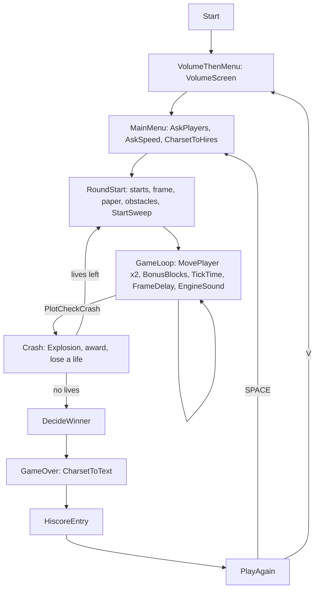

# Light Cycle – Architecture

How the Oric original is put together, read from the disassembly, and how the C64 port is laid out. Oric addresses are
48K addresses; the 16K behaviour is covered below.

---

## Tape and Boot

`CYCLE.TAP` holds two Oric tape blocks ([data_formats.md](data_formats.md)). The first, `LIGHT CYCLE`, is a BASIC
program loaded at `$0501`. Its six lines set `TEXT:INK7:PAPER0`, run `CALL #900` and then `CLOAD""`. `LoaderStart` at
`$0900` uses `BlockCopy` three times: 64 logo glyphs to the alternate character set at `$B900`, two chevron glyphs to
`$B7E0`, and the finished title and instructions screen to `$BB80`. While the player reads it, `CLOAD""` loads the
second block, `GAME`, at `$0400–$1800`. It overwrites the BASIC program and autoruns at `Entry` (`$0400`), which jumps
to `Start`.

---

## Hardware Use (Oric)

The game makes no ROM calls. It drives the hardware itself and borrows a few ROM workspace bytes.

| Area          | How the game uses it                                   |
|:--------------|:-------------------------------------------------------|
| Display       | HIRES 240×200 at `$A000` plus three text rows          |
| Mode switch   | Writes `$1E` (HIRES) or `$1A` (TEXT) to `$BFDF`         |
| Keyboard      | Play: direct matrix scan via VIA port B and AY port A  |
| Menu keys     | ROM IRQ handler; `WaitKey` reads `ROM_KEY` (`$02DF`)   |
| Sound         | AY-3-8912 through VIA port A and the PCR               |
| Timing        | Busy-wait loops (`FrameDelay`, `Delay`)                |
| Randomness    | Additive generator over `$D0–$D3` (`Random`)           |

`RoundStart` masks interrupts and `ViaGameSetup` turns the VIA timer interrupt off, so during play the keys are read
straight from the matrix by `ReadKeysP1` and `ReadKeysP2`. A crash calls `ViaRestoreRom`, which recreates the ROM's 100
Hz timer setup, so the menus and name entry can use the ROM keyboard again.

The "16K OR 48K" line in the BASIC stub works, probably, because a 16K Oric repeats its RAM through the address space:
HIRES `$A000` lands on `$2000` and the HIRES character set `$9800` on `$1800`, directly after the code. That is inferred
from the addresses chosen, not tested.

---

## Memory Map (Oric, 48K)

| Range         | Use                                                    |
|:--------------|:-------------------------------------------------------|
| `$0000–$0008` | Scratch                                                |
| `$0030–$0068` | Game state (the zero-page map at the top of `game.s`)  |
| `$0400–$06BF` | Tables and text; `Entry` at `$0400`                    |
| `$06C0–$17C8` | Code                                                   |
| `$9800–$9EFF` | The TEXT character set, moved here while in HIRES      |
| `$9D00–$9E5F` | Explosion particle state, 11 tables × 32               |
| `$A000–$BF3F` | HIRES bitmap (column 0 = paper attribute)              |
| `$B800–$B8DF` | Hi-score table, 8 × 28 bytes                           |
| `$B900/$B920` | Winner's score and name for `HiscoreEntry`             |
| `$BB80–$BFDF` | TEXT screen: menus and hi-scores                       |
| `$BF68–$BFDF` | HIRES-mode text rows: names, `TIME`, lives, scores     |

The character-set shuffle is the subtlest part. Entering HIRES, `CharsetToHires` copies `$B400–$BAFF` to `$9800–$9EFF`,
because the HIRES bitmap overlays the TEXT character set. Leaving it, `CharsetToText` copies it back. The hi-score table
at `$B800` rides along in the alternate set's area. Before the copy back, `DecideWinner` stores the winner's score and
name at `$9D00` and `$9D20`, so they arrive at `NEW_SCORE` and `NEW_NAME` (`$B900`, `$B920`) ready for `HiscoreEntry`.

---

## Program Flow

`MovePlayer` runs once per player per frame. It reads the keys (or `ComputerAI` and `AIBoost` for a one-player game),
skips odd frames unless boosting, accepts a new direction only when exactly one direction key is down, erases the
three-pixel head (`EraseHead`), steps one pixel, then tests and redraws the head with `PlotCheckCrash`. A crash jumps
straight out of the two subroutine levels to the next round ([quirks.md](quirks.md)).

---

## The C64 Port

The C64 version runs on a platform layer that takes the machine over completely
([platform_layer.md](platform_layer.md)): BASIC and the KERNAL are banked out, the CIA interrupts are off, and one
raster interrupt per frame counts ticks. The video memory sits in VIC bank 1, so text screen, font and bitmap never
overlap and the Oric's character-set shuffle is not needed.

| Range         | Use                                          |
|:--------------|:---------------------------------------------|
| `$0002–$00FF` | Zero page (all free: no KERNAL)              |
| `$0801–$080C` | BASIC stub `10 SYS 2061`                     |
| `$080D–$3FFF` | Code, tables, variables                      |
| `$4400–$47E7` | Text screen (menus)                          |
| `$4800–$4FFF` | Font (a copy of the ROM font for now)        |
| `$5C00–$5FE7` | Bitmap colours: ink and paper per 8×8 cell   |
| `$6000–$7F3F` | Hires bitmap, 320×200                        |
| `$C000–$C0FF` | Hi-score table (reserved)                    |
| `$FFFA–$FFFF` | NMI and IRQ vectors (RAM under the KERNAL)   |

The game keeps the Oric's 240×200 coordinates. The arena is drawn 40 pixels in from the left of the 320-pixel bitmap,
leaving a 40-pixel panel each side for the status rows the Oric showed under its bitmap.
