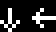
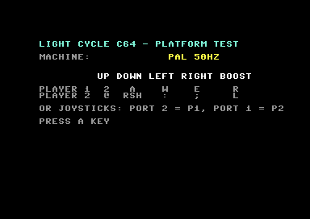
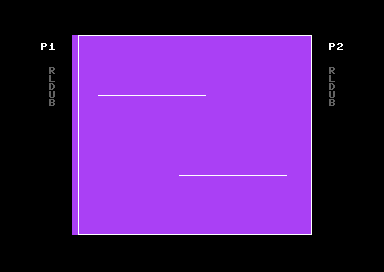

# Light Cycle – Screens and Graphics

The Oric figures are decoded from the tape by `docs/tools/render_graphics.py`; the C64 screenshots are VICE captures of
the current build by `docs/tools/capture_screens.py` (see [html_documentation.md](html_documentation.md)). Oric figures
are drawn 6 pixels per character cell, as the Oric displays them, and enlarged ×4.

---

## The Oric Display

The game plays in HIRES: 240×200 pixels at `$A000`, 40 bytes per line, each byte holding 6 pixels (bits 5–0) with bit 6
set. A byte with bit 6 clear is a serial attribute instead: it sets the ink or paper colour for the rest of the line.
Column 0 of every line holds the paper attribute chosen by `SetPaperColour`, which is why the arena frame starts at x=6.
Below the bitmap, three text rows at `$BF68` show names, lives, `TIME` and scores. Menus and the hi-score table use TEXT
mode (40×28 characters at `$BB80`), with serial attributes for colour, double height and the alternate character set.

`CharsetToHires` and `CharsetToText` copy the character set between `$B400` (TEXT) and `$9800` (HIRES) whenever the mode
changes, because the HIRES bitmap covers the TEXT character set's address ([architecture.md](architecture.md)).

---

## Decoded Figures

The title screen's logo is the publisher's: **PSS**, drawn in the alternate character set from glyphs that `LoaderStart`
copies to `$B900` (`AltGlyphs`).

The status rows show a small cycle beside each player's lives: `GlyphBike`, defined into characters `{` and `|` by
`DefineGlyphs`. The same routine defines `}` and `~` from `GlyphArrows`, used by the volume screen.

`BonusBlocks` animates each new obstacle through five frames of `BonusGfx`, in the order `BonusFrameOfs` gives; the last
frame stays on screen.

`Explosion` sends 32 particles from the crash point (red) toward targets offset by `ExplodeDX` and `ExplodeDY` (yellow),
one Bresenham step per tick, each with a random life of 5–20 ticks, so most stop short of their target.

---

## C64 Build: Phase 1 Platform Test

The Phase 1 harness (`c64/src/main.s`) exercises the platform layer before any game logic is ported. Its text screen
shows the PAL/NTSC detection result and the C64 controls:

Its arena screen is the hires bitmap: the Oric's 240×200 arena drawn 40 pixels in, its frame at the Oric coordinates,
side panels drawn with `BitmapChar`, and two test cycles moving from the Oric's start positions. The panel letters light
up with each player's input bits. Each round takes the next paper colour from the Oric's list.

