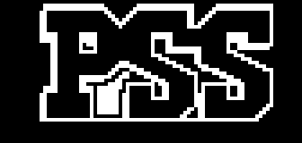
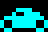
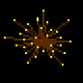
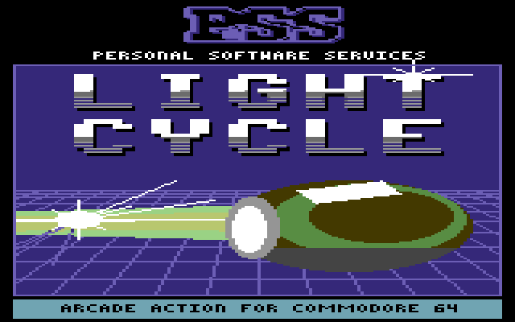
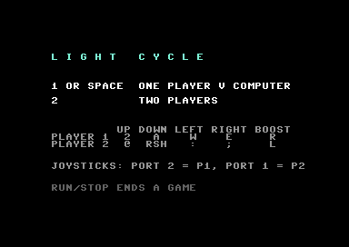
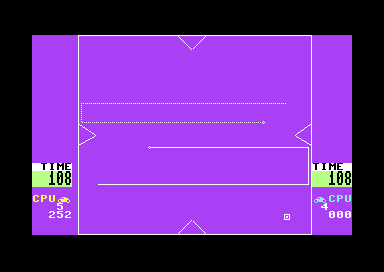
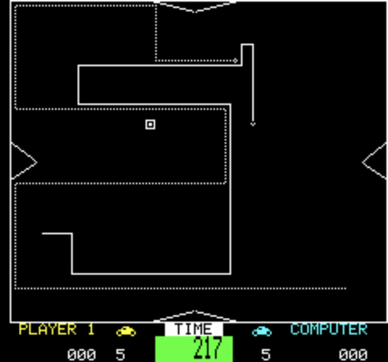
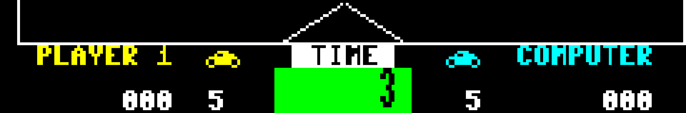
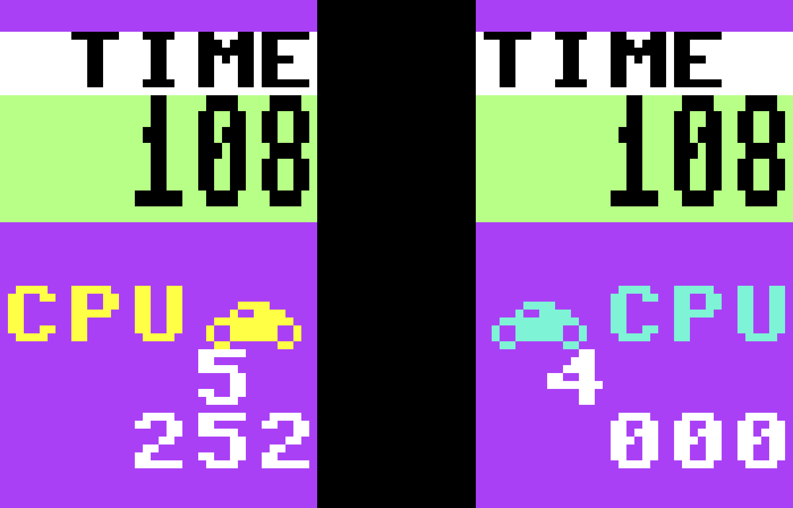

# Light Cycle – Screens and Graphics

The Oric figures are decoded from the tape by `docs/tools/render_graphics.py`; the C64 screenshots are VICE captures of
the current build by `docs/tools/capture_screens.py` (see [html_documentation.md](html_documentation.md)). Oric figures
are drawn 6 pixels per character cell, as the Oric displays them, and enlarged ×4.

---

## The Oric Display

The game plays in HIRES: 240×200 pixels at `$A000`, 40 bytes per line, each byte holding 6 pixels (bits 5–0) with bit 6
set. A byte with bit 6 clear is a serial attribute instead: it sets the ink or paper colour for the rest of the line.
Column 0 of every line holds the paper attribute chosen by `SetPaperColour`, which is why the arena frame starts at x=6.
Below the bitmap, three text rows at `$BF68` show names, lives, `TIME` and scores. Menus and the hi-score table use TEXT
mode (40×28 characters at `$BB80`), with serial attributes for colour, double height and the alternate character set.

`CharsetToHires` and `CharsetToText` copy the character set between `$B400` (TEXT) and `$9800` (HIRES) whenever the mode
changes, because the HIRES bitmap covers the TEXT character set's address ([architecture.md](architecture.md)).

---

## Decoded Figures

The title screen's logo is the publisher's: **PSS**, drawn in the alternate character set from glyphs that `LoaderStart`
copies to `$B900` (`AltGlyphs`).

The status rows show a small cycle beside each player's lives: `GlyphBike`, defined into characters `{` and `|` by
`DefineGlyphs`. The same routine defines `}` and `~` from `GlyphArrows`, used by the volume screen.

`BonusBlocks` animates each new obstacle through five frames of `BonusGfx`, in the order `BonusFrameOfs` gives; the last
frame stays on screen.

`Explosion` sends 32 particles from the crash point (red) toward targets offset by `ExplodeDX` and `ExplodeDY` (yellow).
Each waits a random 5–20 ticks, then travels one Bresenham step per tick as a single moving dot, unplotting the pixel it
leaves, until it reaches its target or the arena's edge. Particles therefore nibble small gaps in the trails and walls
they cross.

---

## C64 Build

The intro picture is new to the C64 version: a multicolour bitmap after the original PSS cassette inlay, drawn by
`tools/make_intro.py` with the PSS logo decoded from the tape. Below is the generator's preview (pixels doubled in
width, as multicolour mode shows them), then the picture as VICE shows it.

The attract cycle then shows the instructions (a placeholder until the Phase 4 menus) and runs demo mode: the computer
against itself, both panels marked CPU. The arena, its wedges, the trails (player 2's dotted) and the bonus blocks are
the Oric's, drawn by the ported code.

The side panels hold the Oric's status rows, rearranged: the next section says how and why.

---

## The Status Layout: Oric and C64

The one visible change to the game's screen on the C64 is where the scores, lives and `TIME` go.

### The Oric Original

The Oric shows its arena on a 240×200 HIRES screen, and the last three lines of the display stay in text mode. The game
writes its status into those three rows (`DrawStatusLine`, $0BC4, from `StatusText`, $0454), across the full width under
the arena, as the long review photographed it in 1983 ([original_release.md](original_release.md)).

The photograph is too soft to read. Here is the same screen captured from the running game (one player against the
computer, partway into a round; pixels ×2), with the Oric's own ROM font:

The figures below are a replica built from the game itself, to tie each part of that screen to the disassembly:
`render_graphics.py` runs the Oric's `ResetScores`, `ResetTime`, `RoundStart` and the first frames of `GameLoop` on
the 6502 core in `tools/cpu6502.py`, then draws the resulting HIRES memory and status rows with the Oric's serial
attributes (ink, paper, double height). The arena, wedges, trails, colours, icon and layout are therefore the
original's, byte for byte. One thing is not: the Oric ROM font is not on the tape, so letters and digits use the C64
font squeezed to the Oric's five-pixel width. The round is chosen to have black paper, as in the capture.

| Row | Left                         | Centre                              | Right                         |
|:----|:-----------------------------|:------------------------------------|:------------------------------|
| 0   | `PLAYER 1` and cycle icon    | `TIME`, black on a white box        | Cycle icon and `COMPUTER`     |
| 1   | –                            | `TIME` digits, top half             | –                             |
| 2   | Score, and lives under icon  | `TIME` digits, bottom half          | Lives under icon, and score   |

Player 1's name is yellow and player 2's (`COMPUTER` or `PLAYER 2`) cyan; scores and lives are white. The `TIME`
digits are double height, black on a green box. The rows take the round's random paper colour, like the arena. At the
end of a match the winner's name is toggled in inverse 25 times.

### The C64 Version

The C64 has no spare rows: its bitmap is 320×200, and the arena's 200 lines fill it. What it has is width. The arena
keeps the Oric's 240-pixel coordinates, centred, which leaves 40 pixels (five character cells) each side. So each
player's half of the status rows is stacked in the panel on their side, at the foot of the panel as the rows were at
the foot of the Oric screen (`hud.s`):

| Panel row | Shows                                          | As the Oric                          |
|:----------|:-----------------------------------------------|:-------------------------------------|
| 16        | `TIME`, black on a white box                   | Row 0, centre                        |
| 17–18     | `TIME` digits, double height, black on green   | Rows 1–2, centre (`BitmapCharTall`)  |
| 20        | Name and cycle icon                            | Row 0, left or right                 |
| 21        | Lives, under the icon                          | Row 2, under the icon                |
| 22        | Score, last five of its eight digits           | Row 2, under the name                |

Left panel: name then icon, as the Oric's left half; right panel: icon then name, as its right half. The colours, the
paper colour, the icon (the Oric's own glyphs from the tape) and the 25 inverse toggles of the winner's name are the
Oric's.

### What Differs, and Why

| Oric                                | C64                                  | Why                                     |
|:------------------------------------|:-------------------------------------|:----------------------------------------|
| Three rows under the arena          | A panel each side, rows stacked      | No rows free under a 200-line arena     |
| One `TIME` box, centre              | A `TIME` box in each panel           | The centre is the arena; keeps symmetry |
| `PLAYER 1`, `PLAYER 2`, `COMPUTER`  | `P1`, `P2`, `CPU`                    | Eight characters; a panel has five      |
| Six `TIME` digits, eight per score  | Five of each shown                   | Five cells; all eight digits are kept   |
| Text characters with attributes     | Glyphs drawn into the bitmap         | The C64 bitmap has no text rows         |

Two other layouts were considered and rejected. Shrinking the arena to make room under it would change the game: every
coordinate, wall and wedge position, and the computer's play, depend on the 240×200 grid. Opening the lower border to
show the rows with sprites would need a raster-timed border trick, eight sprites too few to carry 40 characters, and
separate PAL and NTSC timing; it adds a lot of code for the same information. The panels use space the C64 otherwise
leaves empty and keep the Oric's arena exactly.
