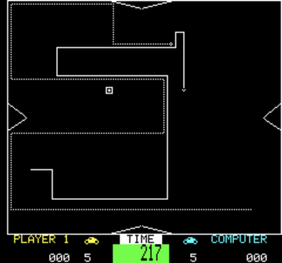
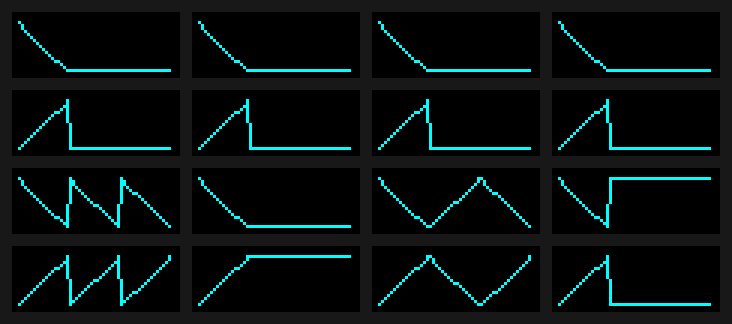

# Light Cycle – Appendix: The Oric

An introduction to the machine *Light Cycle* was written for, for readers who know the C64 but not the Oric. The
history and specifications come from the published sources under [Further Reading](#further-reading); the details of
the screen and the sound chip are read from this repository's disassembly wherever it uses them, and the figures are
drawn by `docs/tools/render_oric.py`. The BASIC examples were run on the Atmos ROM (BASIC 1.1) in the Auric emulator:
all ran without errors, and the drawings and the `POKE` came out as described.

---

## History

The Oric came from Tangerine Computer Systems, a Cambridgeshire company founded by Paul Johnson and Barry Muncaster
that had made the Microtan 65, a 6502 kit computer. After the success of Sinclair's ZX Spectrum, Tangerine set up Oric
Products International to build a cheap colour home computer around the same 6502, and the result was the Oric-1.

| Year | Event                                                      |
|:-----|:-----------------------------------------------------------|
| 1982 | Oric-1 launched in the UK: £129 (16K), £169 (48K)          |
| 1983 | ~160,000 sold in the UK and ~50,000 in France              |
| 1983 | France's best-selling home computer that year              |
| 1983 | Late in the year, Edenspring Investments funds the company |
| 1984 | Oric Atmos (February): real keyboard, ROM V1.1             |
| 1984 | Microdisc drive, MCP-40 colour plotter, modem released     |
| 1985 | Stratos announced (February); receivership the next day    |
| 1985 | Bought by the French firm Eureka                           |
| 1986 | Telestrat: 64K, disk standard, sold mostly in France       |
| 1987 | Second and final receivership (December)                   |

The Oric-1 sold on its price and its colour graphics, against the Spectrum's attribute clash and the higher prices of
the BBC Micro and the C64. Its weak points were the "chiclet" rubber keyboard, an unreliable tape loader and a buggy
first ROM; the Atmos fixed the keyboard and most of the ROM, though not every early program runs on it. In the UK the
machine faded quickly after 1984. In France it stayed popular for several years, which is why so much later Oric
software, and the Telestrat, is French. Compatible clones carried on in Eastern Europe, the best known being Bulgaria's
Pravetz 8D.

*Light Cycle* belongs to the first wave of Oric-1 software: written in 1983 and published on tape by PSS of Coventry,
one of the first companies to support the machine ([original_release.md](original_release.md)).

The community is still active. The Oric.org archive catalogues the software, Defence Force hosts the main forum and
documentation library, and emulators such as Oricutron run the original tapes, this one included.

---

## Specifications

| Part        | Oric-1 and Atmos                                   |
|:------------|:---------------------------------------------------|
| CPU         | 6502A at 1 MHz                                     |
| RAM         | 16K or 48K (64K fitted; 16K hides under the ROM)   |
| ROM         | 16K: Oric Extended BASIC 1.0 (Atmos 1.1)           |
| Video       | ULA (HCS 10017): TEXT, LORES, HIRES modes          |
| Colours     | 8, set by serial attributes                        |
| Sound       | General Instrument AY-3-8912, 3 tone + noise       |
| I/O         | 6522 VIA: keyboard, tape, printer, AY bus          |
| Keyboard    | 57 keys; rubber on the Oric-1, moving on the Atmos |
| Storage     | Cassette at 300 or 2400 baud                       |
| Video out   | RGB (5-pin DIN) and UHF RF                         |
| Other ports | Centronics printer, expansion edge connector       |
| Power       | External 9 V supply                                |

### Memory Map

The map of a 48K machine, as the ROM and this game use it:

| Range         | Holds                                           |
|:--------------|:------------------------------------------------|
| `$0000–$00FF` | Zero page (ROM workspace and program variables) |
| `$0100–$01FF` | 6502 stack                                      |
| `$0200–$02FF` | ROM workspace (key buffer, vectors)             |
| `$0300–$03FF` | I/O: the 6522 VIA at `$0300–$030F`              |
| `$0400–$97FF` | Free RAM (BASIC programs start at `$0501`)      |
| `$9800–$9FFF` | Character sets while in HIRES                   |
| `$A000–$BF3F` | HIRES screen: 200 lines of 40 bytes             |
| `$B400–$B7FF` | Standard character set (TEXT mode)              |
| `$B800–$BB7F` | Alternate character set (TEXT mode)             |
| `$BB80–$BFDF` | TEXT screen: 28 rows of 40 bytes                |
| `$C000–$FFFF` | ROM                                             |

The TEXT screen and its character sets sit inside the HIRES area: switching to HIRES moves the character sets down to
`$9800` and overwrites them, and only the bottom three text rows stay on screen.

---

## Graphics

The ULA reads one byte per 6-pixel cell, 40 cells to a line, and has no colour memory of its own. Colour is set by
**serial attributes**: control bytes placed in the screen itself. An attribute takes up a cell, shows as a blank cell
in the current paper colour, and changes the ink, paper or text style from that cell to the end of the line. Every
line starts again as white ink on black paper.


| 0     | 1   | 2     | 3      | 4    | 5       | 6    | 7     |
|:------|:----|:------|:-------|:-----|:--------|:-----|:------|
| Black | Red | Green | Yellow | Blue | Magenta | Cyan | White |

A colour's number is its RGB bits: bit 0 red, bit 1 green, bit 2 blue.

### Serial Attributes

A screen byte whose bits 6 and 5 are both clear is an attribute; its low five bits say which:

| Value   | Sets                                                       |
|:--------|:-----------------------------------------------------------|
| `0–7`   | Ink colour                                                 |
| `8–15`  | Text style: bit 0 alternate set, bit 1 double, bit 2 blink |
| `16–23` | Paper colour (value − 16)                                  |
| `24–31` | Video mode: bit 2 HIRES, bit 1 50 Hz                       |

Bit 7 of any screen byte inverts its cell: ink and paper are each replaced by 7 minus their value. That is the only
way to get a third colour into a cell without spending a cell on an attribute.

The strip below is one HIRES line of twelve cells, decoded as the ULA does (the grey ruler marks the cells):


| Cell | Byte        | Effect                                      |
|:-----|:------------|:--------------------------------------------|
| 1    | `$14`       | Paper blue (20); the cell itself shows blue |
| 2    | `$03`       | Ink yellow; shows blue                      |
| 3    | `$7F`       | Six pixels on: solid yellow                 |
| 4    | `$55`       | Pixels `010101`: yellow on blue             |
| 5    | `$01`       | Ink red; a blue gap                         |
| 6–7  | `$7F` `$6A` | Solid red, then `101010`                    |
| 8    | `$10`       | Paper black                                 |
| 9    | `$06`       | Ink cyan; shows black                       |
| 10   | `$7F`       | Solid cyan                                  |
| 11   | `$FF`       | Solid, inverted: 7 − cyan (6) = red         |
| 12   | `$40`       | No pixels: black paper                      |

This is the Oric's version of attribute clash: a 6-pixel cell can hold only two colours, and changing either costs a
blank cell. Games work round it by changing colour where the picture is blank anyway, by keeping each line to one or
two colours, and by using the inverse bit.

### The Three Modes

| Mode  | Resolution                  | Cell                                       |
|:------|:----------------------------|:-------------------------------------------|
| TEXT  | 40 × 28 characters          | Character code, 6 × 8 from a character set |
| LORES | 40 × 28 blocks              | Block graphics, 2 × 3 per cell             |
| HIRES | 240 × 200, plus 3 text rows | Bit 6 set: six pixels, bit 5 leftmost      |

Both character sets are in RAM, so every character can be redefined: a game can turn the alternate set into its own
graphics and still have letters in the standard set. Double height prints the top half of each character on even
rows and the bottom half on odd rows, so a double-height line is the same text written on two rows.

HIRES is what *Light Cycle* uses: the arena on the 240 × 200 bitmap, the scores and timer in the three text rows
underneath, set out with serial attributes.



### From BASIC

Oric BASIC has commands for each mode. HIRES draws with a graphics cursor; the last parameter is the foreground mode
(0 paper, 1 ink, 2 invert, 3 move only):

```basic
10 HIRES
20 INK 6:PAPER 0
30 CURSET 120,100,1:CIRCLE 60,1
40 CURSET 20,20,1:DRAW 200,0,1:DRAW 0,160,1
50 FOR X=0 TO 239 STEP 4:CURSET X,199,1:DRAW 0,-20,2:NEXT
60 PRINT "HELLO FROM THE TEXT ROWS"
```

`TEXT` returns to text mode and `LORES 0` or `LORES 1` selects block graphics with the standard or alternate set.
Attributes can be poked straight into the screen: `POKE #BB80+40*5,17` makes row 5 red paper from its first cell.

---

## Sound

The AY-3-8912 is General Instrument's AY-3-8910 (the MSX's sound chip) in a smaller package with one I/O port instead
of two; the ZX Spectrum 128 and the Amstrad CPC use the same part. On the Oric it is clocked at 1 MHz.

| Feature  | AY-3-8912 on the Oric                                      |
|:---------|:-----------------------------------------------------------|
| Tone     | Channels A, B, C: square waves, 12-bit period              |
| Pitch    | 1 MHz ÷ (16 × period): ~15 Hz (period 4095) up to 62.5 kHz |
| Noise    | One generator, 5-bit period, mixable into any channel      |
| Volume   | 0–15 per channel, or the envelope                          |
| Envelope | One shared generator: 16-bit period, 16 shapes             |
| I/O port | Port A: drives the keyboard's column lines on the Oric     |

### Registers

| Register | Holds                                                       |
|:---------|:------------------------------------------------------------|
| R0–R1    | Channel A tone period (fine, coarse 4 bits)                 |
| R2–R3    | Channel B tone period                                       |
| R4–R5    | Channel C tone period                                       |
| R6       | Noise period, 0–31                                          |
| R7       | Mixer: tone off (bits 0–2), noise off (3–5), port A out (6) |
| R8–R10   | Volume 0–15; bit 4 hands the channel to the envelope        |
| R11–R12  | Envelope period (fine, coarse)                              |
| R13      | Envelope shape                                              |
| R14      | I/O port A                                                  |

One envelope cycle lasts 256 × period µs at 1 MHz: from 0.26 ms to about 16.8 s. *Light Cycle*'s explosion uses
period `$1904`, a single fall of about 1.6 s ([sound.md](sound.md)).



Shapes 0–3 and 4–7 are one fall or one rise and then silence; 8–15 repeat or hold, set by R13's bits: continue (3),
attack (2), alternate (1) and hold (0).

### How the Oric Reaches the Chip

The AY is not memory-mapped. Its data bus hangs off the VIA's port A and its two bus-control lines off the VIA's CA2
and CB2 outputs (set through the PCR at `$030C`), so every register write is two VIA operations: select the register,
then write the value. *Light Cycle*'s `AyWrite` does exactly that. Because the keyboard's column lines come from the
AY's own I/O port, reading the keyboard also goes through the AY, which is why R7 bit 6 must stay set.

### From BASIC

```basic
10 PING:WAIT 50:SHOOT:WAIT 50:EXPLODE:WAIT 50:ZAP
20 SOUND 1,500,10
30 MUSIC 2,3,5,10
40 PLAY 3,0,1,2000
```

`PING`, `SHOOT`, `EXPLODE` and `ZAP` are ready-made effects. `SOUND channel,period,volume` plays a tone (channels 1–3)
or noise (4–6); `MUSIC channel,octave,note,volume` plays a note (octave 0–6, note 1–12 from C); `PLAY tone,noise,
mode,period` switches channels on (bit masks) and starts the envelope. A volume of 0 hands the channel to the envelope.

---

## How Light Cycle Uses the Oric

The game makes no ROM calls during play. `RoundStart` masks interrupts and `ViaGameSetup` turns off the VIA's 100 Hz
timer, so the keys are read straight from the matrix (`ReadKeysP1`, `ReadKeysP2`) through VIA port B and AY port A;
`ViaRestoreRom` puts the timer back for the menus. The arena is HIRES with a paper attribute in column 0 of every line,
and the status rows use ink, paper and double-height attributes (`DrawStatusLine`, `TimeAttrL`). All the sound is AY
register writes through `AyWrite` and `AyLoadAll`. [architecture.md](architecture.md) has the full detail, and
[porting.md](porting.md) how each part maps onto the C64.

---

## Running the Original in an Emulator

The original tape runs in any Oric emulator that reads `.tap` files. Two good choices are
[Auric](https://github.com/pugo/Auric), used to check this appendix's BASIC examples, and
[Oricutron](https://github.com/pete-gordon/oricutron), the long-standing multi-platform emulator.

### The ROMs

No emulator ships the Oric ROMs. They are archived at [oric.free.fr/ROMS](http://oric.free.fr/ROMS/), one zip per ROM.
Auric looks for three files in its `ROMS/` folder, under these names; the SHA1 sums are the ones its
`ROMS/README_ROMS.md` lists as tested:

| Auric file     | From the archive | Machine           | SHA1                                       |
|:---------------|:-----------------|:------------------|:-------------------------------------------|
| `basic10.rom`  | `Basic1.0.zip`   | Oric-1, BASIC 1.0 | `333116e6884d85aaa4dfc7578a91cceeea66d016` |
| `basic11b.rom` | `Basic1.1.zip`   | Atmos, BASIC 1.1  | `9451a1a09d8f75944dbd6f91193fc360f1de80ac` |
| `microdis.rom` | `Oricdisc.zip`   | Microdisc drive   | `0d2ef6e67322f48f4b7e08d8bbe68827e2074561` |

Unzip each archive, rename the ROM to the name in the first column, and check it with `shasum`. Auric refuses to
start unless all three are present, even with no disk in use: the Microdisc ROM is only switched in when a disk image
is given, but the file is loaded at start-up.

### Building and Running Auric

Auric builds with CMake against four libraries, which Homebrew provides on macOS (`argparse`, `spdlog`, `sdl3`,
`yaml-cpp`; the repository's `doc/BUILD_HOST.md` has the details and a vcpkg alternative):

```bash
git clone https://github.com/pugo/Auric.git
cd Auric && mkdir build && cd build && cmake .. && make -j10
```

Run it from the `Auric` folder, since it reads `auric.yaml` and `ROMS/` from the current directory. The binary may be
`build/auric` or `build/src/auric`, depending on the build. `--oric1` selects the Oric-1 ROM, the machine *Light Cycle*
was written for (the default is the Atmos), and `--tape` loads and starts a tape:

```bash
cd Auric && ./build/src/auric --oric1 --tape /path/to/LightCycle/CYCLE.TAP
```

F1 opens Auric's menu (settings, tape and disk images, rewind), Shift-Ctrl-W toggles warp speed and Shift-Ctrl-R
resets. On a real Oric, or with autostart turned off, type `CLOAD""` and press Return to load the tape.

---

## Further Reading

| Resource                                                                                             | What it offers                                   |
|:-----------------------------------------------------------------------------------------------------|:-------------------------------------------------|
| [Oric (computer), Wikipedia](https://en.wikipedia.org/wiki/Oric_(computer))                          | History, models, specifications, sales           |
| [History of the Oric Home Computer](https://quantumzeitgeist.com/history-of-the-oric-home-computer/) | Readable overview; check dates against Wikipedia |
| [The Oric Site (oric.org)](https://www.oric.org/)                                                    | Software archive, screenshots, cover scans       |
| [Light Cycle on oric.org](https://www.oric.org/software/light_cycle-1432.html)                       | This game's entry                                |
| [Defence Force](https://www.defence-force.org/computing/oric/index.htm)                              | Hardware notes, manuals library, forum           |
| [Oricutron](https://github.com/pete-gordon/oricutron)                                                | Emulator: Oric-1, Atmos, Telestrat, Pravetz      |
| [Auric](https://github.com/pugo/Auric)                                                               | Emulator: Oric-1, Atmos, Microdisc, debugger     |
| [Oric ROM archive](http://oric.free.fr/ROMS/)                                                        | BASIC 1.0 and 1.1, Microdisc and other ROMs      |
| [AY-3-8910, Wikipedia](https://en.wikipedia.org/wiki/General_Instrument_AY-3-8910)                   | The sound chip family and its registers          |
