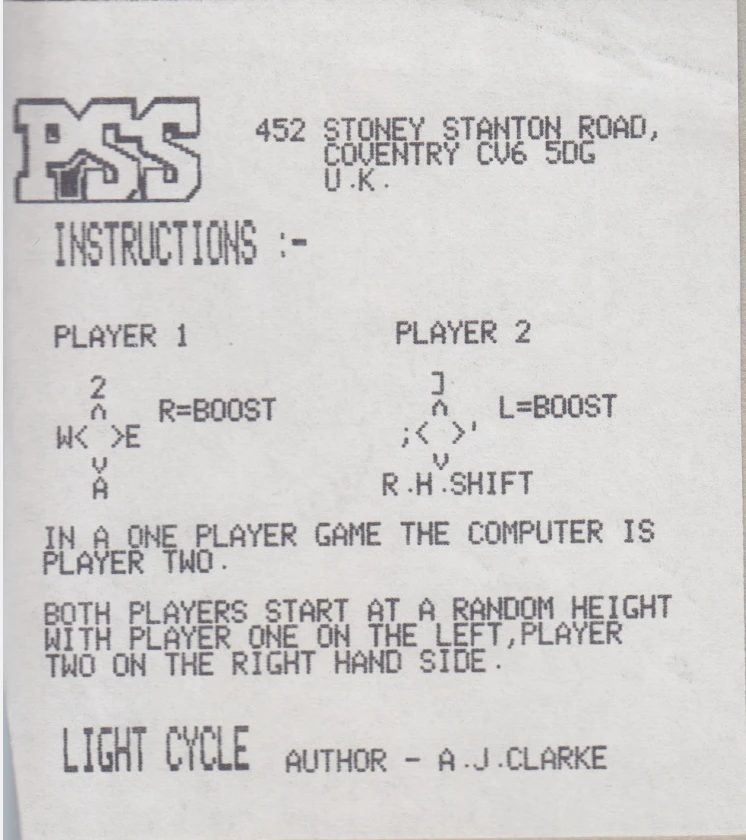
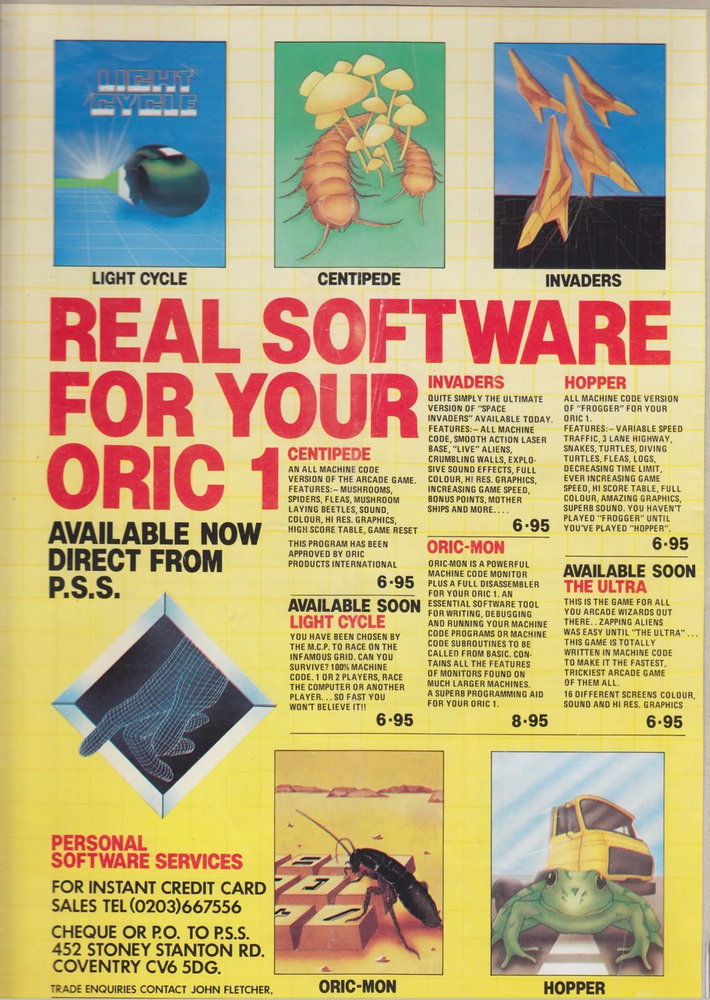
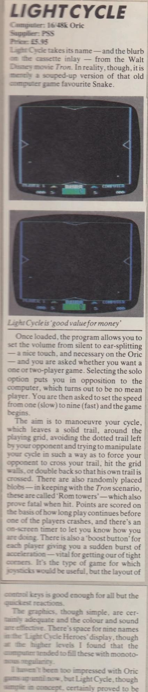
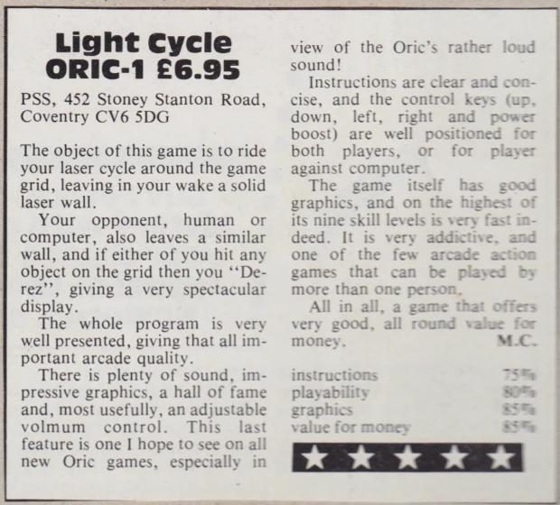
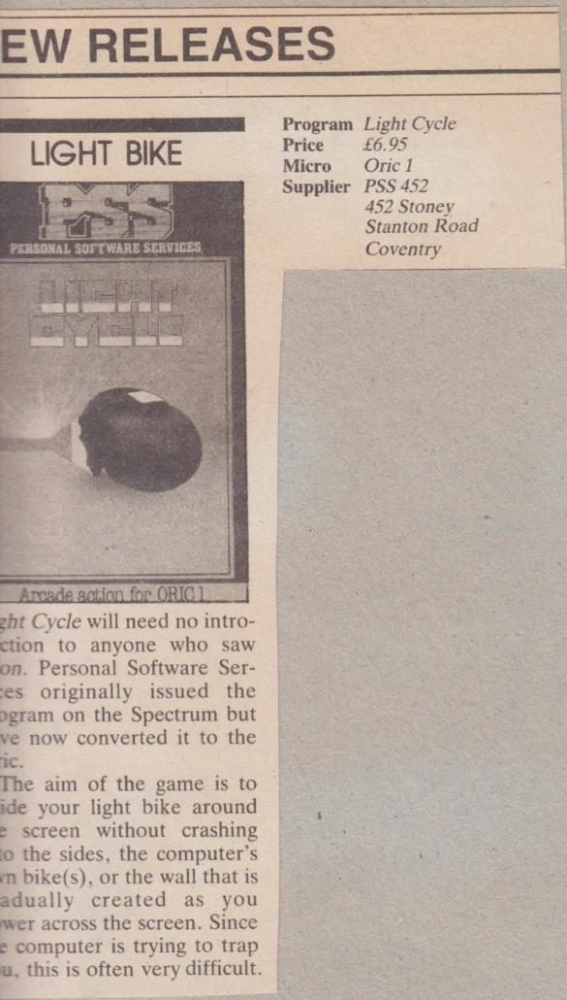
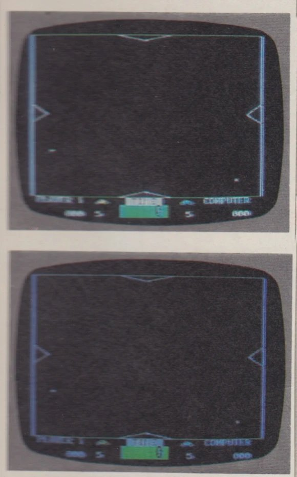
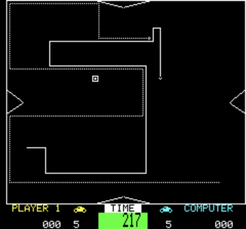

# Light Cycle – The Original Release

---

## How It Was Written

I wrote *Light Cycle* in 1983 on an original Oric-1. I wrote the program out by hand on paper and then entered it into
the Oric with Oric-Mon, my machine code monitor ([Oric-Mon](#oric-mon), below). PSS published it on cassette, and everything in this repository starts from that
tape. The release is catalogued on [Oric.org](https://www.oric.org/software/light_cycle-1432.html).

---

## The Cassette Instructions

This is the instruction sheet that came with the PSS cassette, printed on the Oric's own printer. It carries the same
text as the game's title screen: the PSS logo and address, both players' keys drawn as a compass, the one-player rule
and the author credit.

The keys on the sheet are the ones the disassembly reads, and the C64 port keeps their shape
([player_guide.md](player_guide.md)):

| Player   | Up  | Left | Right | Down        | Boost |
|:---------|:----|:-----|:------|:------------|:------|
| Player 1 | `2` | `W`  | `E`   | `A`         | `R`   |
| Player 2 | `]` | `;`  | `'`   | Right SHIFT | `L`   |

---

## The PSS Advert

PSS ran a full-page advert, "Real Software for your Oric 1", with the *Light Cycle* inlay in the top-left corner. Light
Cycle is listed under "Available soon" at £6.95, beside Centipede, Invaders,
[Hopper](https://github.com/anthonyjclarke/Hopper-Oric), Oric-Mon and The Ultra. Its blurb sells the *Tron* setting
(the M.C.P. and the grid), one or two players against each other or the computer, and 100% machine code.

---

## The Reviews

Here are two reviews and a New Releases column, cut down to the *Light Cycle* parts.

The long review lists the game for the 16K or 48K Oric, from PSS at £5.95. It walks through the volume, players and
speed questions, the boost key, the on-screen timer and the nine-name *Light Cycle Heroes* table, and calls the
randomly placed blocks "Rom towers". The caption sums it up as "good value for money".

The boxed review, signed M.C., lists the game as *Light Cycle ORIC-1* at £6.95 and gives it five stars:

| Rating          | Score |
|:----------------|:------|
| Instructions    | 75%   |
| Playability     | 80%   |
| Graphics        | 85%   |
| Value for money | 85%   |

It picks out the adjustable volume as a plus, given how loud the Oric's sound is.

A "New Releases" column introduces the game under the heading *Light Bike*, at £6.95, with the PSS inlay photographed
and its "Arcade action for ORIC 1" strip. The column says PSS first issued the program on the Spectrum.

---

## The Screens in the Review

The long review's two photographs show the same tape version this repository disassembles. You can see the arena, the
wedge at the middle of each wall, and the three text rows under the HIRES screen that `DrawStatusLine` ($0BC4) fills
from `StatusText` ($0454).

Here's the same screen captured from the running game, one player against the computer partway into a round:

[graphics.md](graphics.md) (The Status Layout) compares it with the C64 panels.

| Photograph                              | Disassembly                                  |
|:----------------------------------------|:---------------------------------------------|
| `PLAYER 1` and cycle icon, left         | `StatusText` ($0454)                         |
| `TIME` in a white box, centre           | Attributes `$00`, `$17`: black on white      |
| `COMPUTER` and cycle icon, right        | `StatusP2Name` ($0472), or `PLAYER 2`        |
| Big digits in a green box under `TIME`  | `TimeAttrL` ($0488): double height, green    |
| `000` and `5` each side                 | Scores and lives, rows 1–2                   |

The arena is 200 pixels high on both machines, and the C64 screen has no rows left under it. So the port stacks each
player's half of the status rows in a panel on their side of the arena: the same white `TIME` box over double-height
digits on green, the names in the same colours beside the cycle icon, lives under the icon and the score under the
name. Only the names are shortened, to `P1`, `P2` and `CPU`, so they fit in five cells. [graphics.md](graphics.md)
compares the two layouts in full and explains why the C64 one differs.

---

## What the Clippings Add

| Detail                 | Source                          |
|:-----------------------|:--------------------------------|
| Price £6.95            | PSS advert, M.C. review, column |
| Price £5.95            | Long review                     |
| 16K or 48K Oric        | Long review, the BASIC stub     |
| "Rom towers"           | Long review                     |
| Status rows on screen  | Long review's photographs       |

The 16K or 48K claim matches the `16K OR 48K` line in the tape's BASIC stub ([architecture.md](architecture.md)). The
inlay artwork here is what the C64 intro picture is based on ([graphics.md](graphics.md)).

---

## Oric-Mon

I wrote *Light Cycle*, like *Hopper*, with Oric-Mon, a machine code monitor for the Oric-1 that PSS also published in
1983, credited to A. J. Clarke. It's in the PSS advert above as well. I pulled it together rather than
writing all of it: some of it wasn't my own work, and I can't remember now where those parts came from. What it gave me
was a way to type the code straight in, then disassemble it and check it as I went along.

Oric-Mon has its own page on oric.org: [Oric-Mon](https://www.oric.org/software/oric_mon-79.html). It has the tape
images, the inlay, scans of the tape labels, two screenshots and the manual, in English and in French. The page records
two releases:

| Release | Machines      | Tape                                                  | Manual  |
|:--------|:--------------|:------------------------------------------------------|:--------|
| First   | Oric-1        | `oricmon.tap`                                         | English |
| Second  | Oric-1, Atmos | Side 1 `oricmono.tap` (Oric-1); side 2 `oricmona.tap` | French  |

The second release used the same "Oric-1" inlay with a yellow "Atmos compatible" sticker added. Its side 1 is the
Oric-1 version with the end address cut from `$B1FF` to `$B180`, because the bytes past `$B180` were only whatever was
in memory when the tape was saved. The page recommends the English manual over the French one.

Oric-Mon is the next Oric restoration after *Hopper* and *Light Cycle*, along with John Marshall's *The Ultra*
([credits.md](credits.md)).
